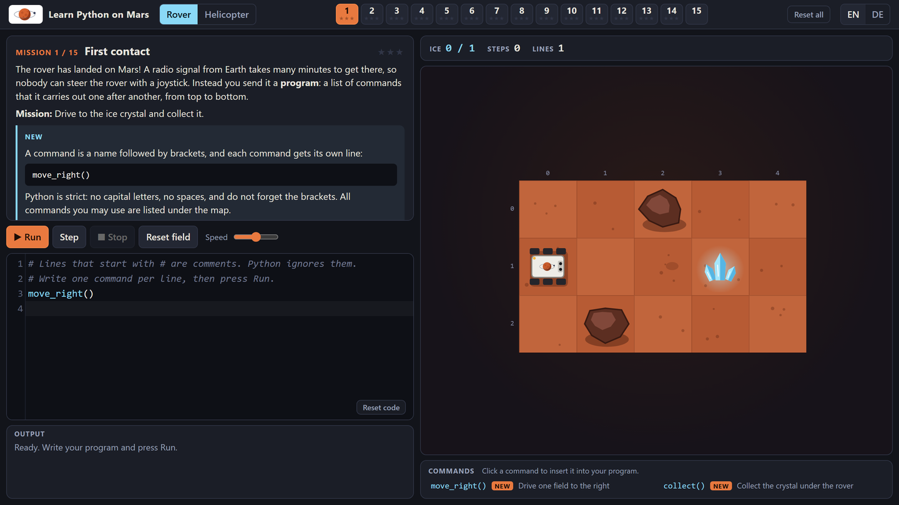
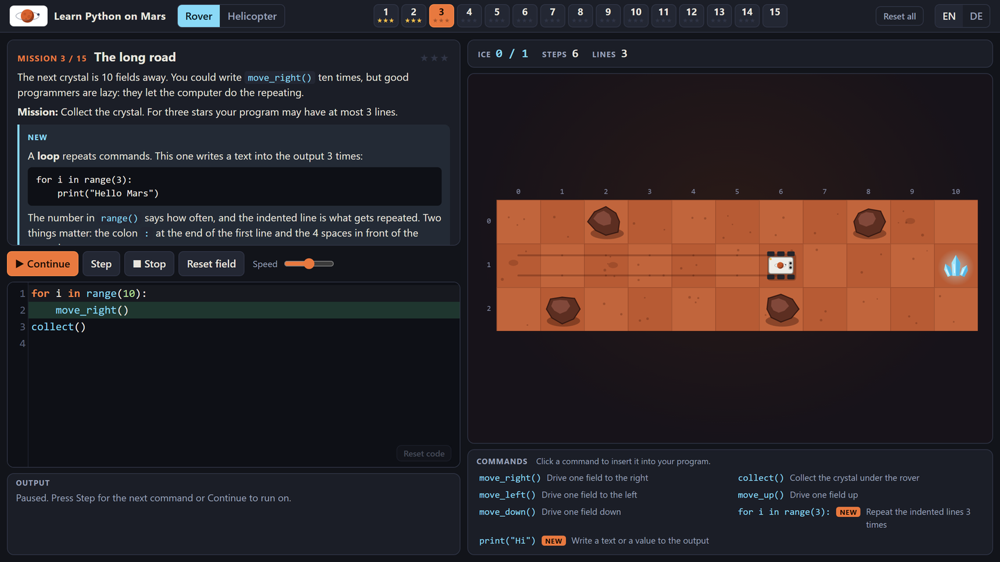
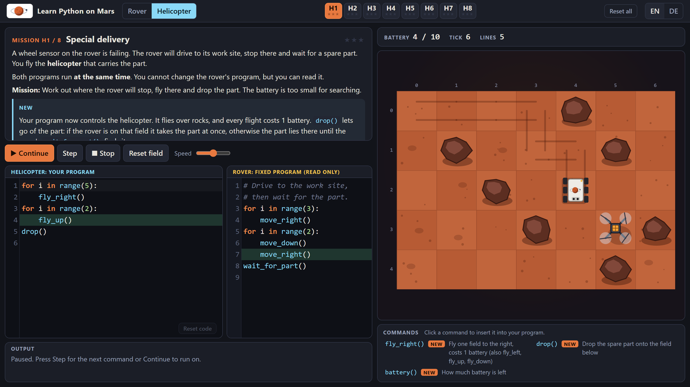
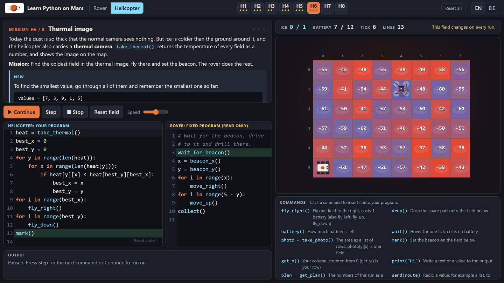

# Learn Python on Mars

**A browser-based way to teach Python to beginners, free for schools and all other non-commercial use: students write real Python and steer a rover across Mars.**

**[▶ Try it online](https://baumsebastian.github.io/Learn-Python-On-Mars/)** — nothing to download, it runs in your browser.

For the classroom there is also an offline version: no installation, no accounts, no internet. Download the folder, open `index.html`, start teaching.

## Why it works in a classroom

- **Real Python, not blocks.** What students type here is what they would type anywhere else.
- **Instant feedback.** Every command moves the rover, and the line being executed is highlighted.
- **Mistakes are explained.** A crash, a typo or a missing colon gets a plain message with the line marked.
- **Nothing to set up.** It runs from a folder or a USB stick on any PC with a browser, also offline.
- **English and German.** One click switches every text; the Python stays the same.
- **Room for everyone.** Beginners solve missions step by step, stars reward shorter programs, and a second track challenges students who already program.

## Two tracks, 23 missions

### Rover track: the basics

Fifteen short missions, each adding one idea. Designed for about three hours with students who have never programmed.

| # | Missions | New idea |
|---|----------|----------|
| 1–2 | First contact, Around the rocks | Commands in sequence |
| 3–6 | The long road … Around the corner | `for` loops |
| 7 | The big field | Loops inside loops |
| 8–9 | Look first, After the storm | `if` with a sensor |
| 10–11 | Into the unknown, The canyon | `while` |
| 12 | Your own commands | `def` |
| 13 | Ice or stone? | A value in the brackets: `is_sample("ice")` |
| 14 | The pyramid | Loop variable, `range(1, 6)`, `print()` |
| 15 | Free exploration | Variables, open-ended |

From mission 8 on the field changes on every run, so a route cannot simply be written down once.

### Helicopter track: for students who already program

Here the rover runs a fixed program that students can read but not change. Their own program flies a helicopter, and both run in step. The focus shifts from writing commands to **reading code, working with data and optimising**.

| # | Mission | What it trains |
|---|---------|----------------|
| H1 | Special delivery | Tracing someone else's loops to predict where the rover stops |
| H2 | Moving target | Timing: be at the right field in the right tick |
| H3 | Aerial photo | 2D lists: `photo[y][x]` and loops over indexes |
| H4 | According to plan | Calculating with list elements that change every run |
| H5 | Radio contact | Building a list and sending it to another program |
| H6 | Thermal image | Searching a grid of numbers for its minimum |
| H7 | Short on battery | Reading a given program and optimising it |
| H8 | Piece by piece | Merging six small photos into one map by shifting indexes |

## Get started

The quickest way is the [online version](https://baumsebastian.github.io/Learn-Python-On-Mars/). To run it offline, for example in a classroom without internet:

1. Download this project: on GitHub, click **Code** and then **Download ZIP**.
2. Unpack the ZIP. The page does not work from inside the ZIP.
3. Open the folder and double-click `index.html`.
4. In mission 1, press **Run**. The rover should drive one field to the right.

That is all. A PC needs a current browser (Edge, Chrome or Firefox) and about 2 MB of space. It needs no internet, no Python and no admin rights.

## Using it in class

**Putting it on the PCs.** Copy the unpacked folder to a USB stick or a network share, then onto each PC, for example the Desktop. You can also open `index.html` straight from a network share.

**Solutions.** Open `index.html?teacher` to get a **Solution** button in the editor. The sample solutions are in `teacher/solutions.js`; delete the `teacher` folder on student PCs if they should not be there.

**On the projector.** **Step** runs one command at a time and highlights the line, which makes it easy to talk through a program.

**Stars.** Every rover mission can be solved the long way for one star; loops earn three. In the helicopter track stars count battery used.

**Before the next class.** Progress and programs are saved in the browser of each PC. Click **Reset all** at the top right to clear them; the chosen language stays. Opening `index.html?reset` does the same without asking.

**If something does not work**

| What you see | Likely reason |
|--------------|---------------|
| Plain text without colours, or an empty page | The folder is incomplete. `css`, `js`, `vendor` and `assets` must lie next to `index.html`. |
| The page is still inside a ZIP | Unpack the ZIP first, then open `index.html` from the unpacked folder. |
| `index.html` opens in the wrong program | Right-click it, choose **Open with** and pick a browser. |
| Progress is gone after a restart | Some school PCs wipe browser data on shutdown. The course still works; students start at mission 1. |
| Progress is gone after moving the folder | The browser stores progress per location. Leave the folder where it is during the course. |

## Make it your own

Everything is plain HTML, CSS and JavaScript. There is no build step: change a file and reload the page.

| File | What you change there |
|------|-----------------------|
| `assets/logo.png` | The logo in the top bar and on the rover: replace this file with your school's or institute's logo |
| `js/config.js` | The logo's file name and hover text, if you want a different file or no logo |
| `js/levels.js` | Missions: maps, texts in both languages, star limits. The map format is explained at the top of the file. |
| `js/i18n.js` | Button labels and messages |
| `js/game.js` | Rules and drawing of rover, helicopter and map |
| `js/runner.js` | The Python commands students can use |
| `js/app.js` | The page itself |

A new mission is one entry in `js/levels.js`: a small text map, a few sentences and a star limit.

## Contributing

Ideas, fixes and new missions are welcome.

- **Have an idea or found a problem?** Open an issue and describe it. For a bug, say which mission, which browser, and what you typed.
- **Want to add something yourself?** Send a pull request. For anything larger than a small fix, open an issue first so we can agree on the direction before you put in the work.

Good first contributions:

- **A new mission.** Add one entry to `js/levels.js` with the map and the texts, and a sample solution to `teacher/solutions.js`.
- **A translation.** The texts are in `js/i18n.js` and `js/levels.js`, each with an `en` and a `de` version next to each other.
- **A fix** for a confusing message, a typo or a mission that can be solved in an unintended way.

Before you send a pull request:

1. Open `index.html?teacher`, go to your mission and click **Solution**: the sample solution must finish the mission. If the field is random, run it several times.
2. Write every text in English and German. If you only speak one of them, say so in the pull request and someone will add the other.
3. Keep it dependency-free: no build step and no files loaded from the internet, so it keeps working offline.

By contributing you agree that your contribution is published under the same licence as the project.

## How it is built

- **[Skulpt](https://skulpt.org/)** runs Python in the browser.
- **[CodeMirror](https://codemirror.net/5/)** is the editor.

Both are MIT-licensed and included in `vendor/`, which is why no internet is needed.

Tested with Microsoft Edge, opened directly from the folder.

## Credits

Created by Sebastian Baum.

The idea of learning to program by steering a machine across a field was inspired by the game [The Farmer Was Replaced](https://store.steampowered.com/app/2060160/The_Farmer_Was_Replaced/). This project is not affiliated with it and shares no code, artwork or levels with it.

## Licence

Learn Python on Mars is free to use, change and share for **non-commercial purposes** under the [PolyForm Noncommercial License 1.0.0](LICENSE.md). That includes schools, universities, clubs, charities and private use. Commercial use is not permitted.

Required Notice: Copyright Sebastian Baum

The bundled libraries in `vendor/` keep their own MIT licences, which are included next to them.
